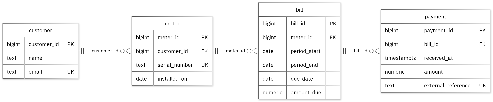

# MIT 8103 Advanced Database Systems

**Electricity / Utility Billing System** · Semiu Muniru · Student ID 301865524

## Case study

For this project, I designed a relational database for an Electricity and Utility Billing System built around the everyday workflows of billing clerks, accounts staff, and customers checking their statements. To keep the data clean and easy to manage, I organized the system into four core tables: customer, meter, bill, and payment. Together, these tables power the full billing lifecycle—allowing staff to register new customers and assign meters, generate periodic bills from meter readings, log incoming payments against specific invoices, and give both accounts teams and customers a clear view of billing history and total payments.

## Portfolio 1: Database Design and Modelling

I structured the relational schema across four core tables, relying on primary keys to uniquely identify every record, foreign keys to keep related entries properly connected, and check constraints to enforce the utility's business rules—such as ensuring a bill's amount due can never drop below zero. To confirm the schema was cleanly structured, I mapped out normalization examples walking the sample data step by step through 1NF, 2NF, and 3NF. During validation testing, the database caught and rejected all 30 intentionally invalid insert attempts while leaving the valid sample records completely intact.

Figure 1. Tables, keys and relationships. PK: primary key; FK: foreign key; UK: unique value.

<!-- PAGE BREAK -->

## Portfolio 2: Query Processing and Optimisation

To verify query accuracy, I executed three SQL queries against the sample dataset, including a join query that returned a single matching record linking meter MTR-1001 to customer Avery Morgan. For performance benchmarking, I generated a separate test dataset of 20,000 rows to measure the impact of indexing. Introducing the new index reduced the median lookup time from 0.944 ms to 0.179 ms. Both test phases returned identical result sets, and the query execution plan confirmed that the database actively used the new index. Note that these timing figures are specific to this query and testing environment.

## Portfolio 3: Transactions and Concurrency

To test transaction control and concurrent access, I added a temporary counter column to the payment table to observe COMMIT, ROLLBACK, and READ COMMITTED isolation behavior. As expected, uncommitted updates remained invisible to the second session, and running ROLLBACK cleanly restored the previously committed value. During concurrency testing without row-level locking, two simultaneous increments caused a lost update and left the counter at 2. Applying SELECT FOR UPDATE resolved this by making Session B wait until Session A finished, producing the accurate final value of 3. This temporary helper column was strictly limited to this exercise, leaving all of the case study's original business fields completely unchanged.

## Portfolio 4: NoSQL and Advanced Data Models

For document-based event tracking, I created a MongoDB collection named billing_events to store the system's event records. After inserting two sample event documents, the database returned the expected results across four test queries. Schema validation rules successfully caught and rejected both an invalid date data type and a duplicate event ID. Using embedded snapshots keeps relevant customer and meter context bundled directly inside each event document, while a flexible details field adapts its structure depending on the specific event type. These records serve as fictional test events, while PostgreSQL continues to act as the core system enforcing strict relational integrity.

## Repository and evidence

https://github.com/EngrKola123/Muniru_Semiu_301865524

The portfolio folders contain the SQL and JavaScript, explanations, query plans, result tables and screenshots.

<!-- PAGE BREAK -->

## Portfolio 5: Distributed and Cloud Database Exercise

For system resilience, I proposed setting up three MongoDB replica members spread across separate failure zones. My discussion walks through how primary elections work, why majority write acknowledgements matter, how secondary lag can occur, and what trade-offs come with sharding billing_events. I also emphasized why replication keeps the system running during outages while backups are still essential for true data recovery, noting that PostgreSQL needs a separate availability plan of its own. Since this follows the permitted discussion option, it outlines the architectural design without deploying a live cluster or running failover tests.

## Individual reflection

Separating customer, meter, bill, and payment into distinct tables allows each entity to be maintained cleanly without repeating details across every related record. Enforcing business rules—such as preventing a bill's amount due from ever turning negative—was verified through constraint tests alongside required fields and foreign key links. The two-session concurrency exercise demonstrated how two sessions can read the same uncommitted value simultaneously, leading to a lost update unless the row is locked prior to reading so both increments are preserved. Finally, the index comparison highlighted why inspecting the query execution plan matters just as much as checking the final output, showing that identical results can require vastly different amounts of underlying database work.

## AI-use declaration

I utilized GitHub Copilot and the portfolio generator to assist in preparing the database model, scripts, and written explanations. The generator executed the PostgreSQL and MongoDB exercises, verified their outputs, and captured the supporting result images, while I remain fully responsible for reviewing, validating, and explaining all submitted work. Beyond these tools, the project files were developed and refined over a five-week period leading up to today's final commit to GitHub. Overall, it has been a genuinely rewarding and insightful project to work on.

## References

- [PostgreSQL: constraints](https://www.postgresql.org/docs/17/ddl-constraints.html)
- [PostgreSQL: EXPLAIN](https://www.postgresql.org/docs/17/using-explain.html)
- [PostgreSQL: isolation](https://www.postgresql.org/docs/17/transaction-iso.html)
- [PostgreSQL: row locks](https://www.postgresql.org/docs/17/explicit-locking.html)
- [MongoDB: data modelling](https://www.mongodb.com/docs/manual/data-modeling/)
- [MongoDB: replication](https://www.mongodb.com/docs/manual/replication/)
- [MongoDB: sharding](https://www.mongodb.com/docs/manual/sharding/)
- [Mermaid: ER diagrams](https://mermaid.js.org/syntax/entityRelationshipDiagram.html)

